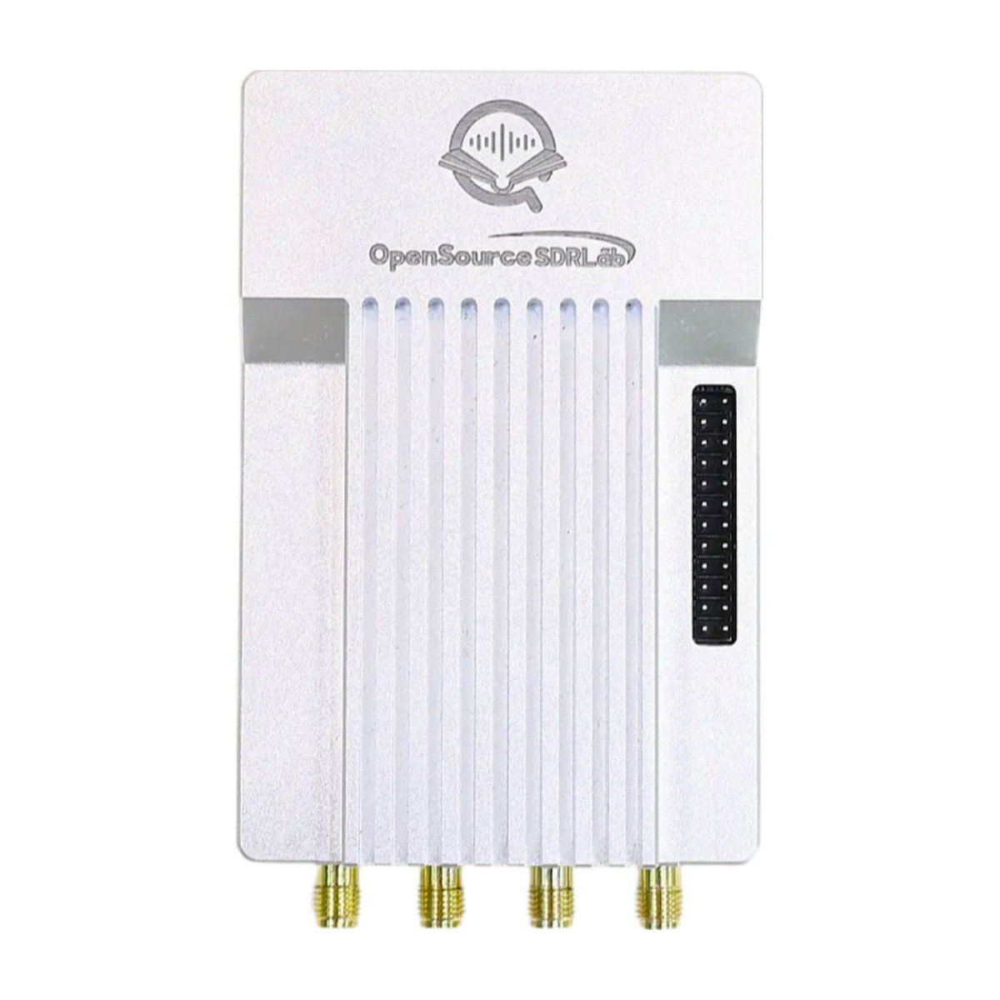
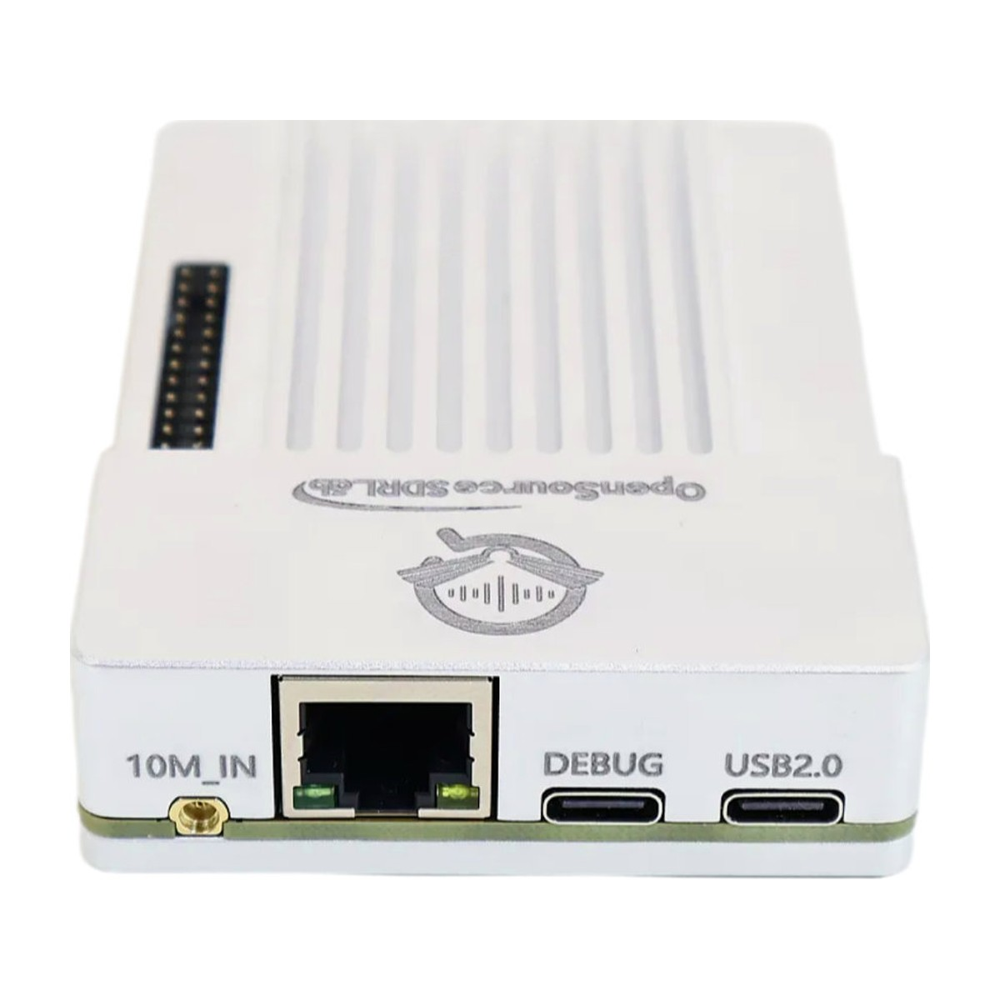

# PlutoSky-R2

Hardware files, firmware and documentation for the **OpenSourceSDRLab PlutoSky R2**, a PlutoSDR-compatible software-defined radio with a Zynq-7020 (CLG484), an AD9361 or AD9363 transceiver, Gigabit Ethernet on the FPGA and a hardware-locked 10 MHz reference.

  
  

## Product link

<https://opensourcesdrlab.com/products/plutosky-r2>

## User manual

- PlutoSky R2 User Manual: <https://blog.opensourcesdrlab.com/archives/plutosky-r2-user-manual>
- Tezuka firmware on the PlutoSky R2: <https://blog.opensourcesdrlab.com/archives/plutosky-r2-tezuka-firmware-user-manual>
- openwifi on the PlutoSky R2: <https://blog.opensourcesdrlab.com/archives/plutosky-r2-openwifi-user-manual>

Videos:

- PlutoSky R2 on Windows: <https://www.youtube.com/watch?v=a-ufK1EsBNM>
- PlutoSky R1 and R2 on Ubuntu: <https://www.youtube.com/watch?v=t9zjT0DF9BU>, <https://www.youtube.com/watch?v=1UBGZGpJbus>

## About the board

- RF transceiver: Analog Devices **AD9361** or **AD9363** (by SKU), 2 transmit and 2 receive channels on SMA connectors; optional transmit amplifier (by SKU)
- SoC: Xilinx Zynq **XC7Z020-2CLG484I**, 1 GB DDR3, QSPI flash, microSD slot
- Interfaces: **Gigabit Ethernet connected to the PL** (FPGA), USB-C **USB 2.0** (OTG), USB-C **DEBUG** (JTAG + UART), GPIO expansion header
- Clocking: **10 MHz reference input** (10M_IN) locks the on-board 40 MHz oscillator through a hardware PLL; external 40 MHz clock option
- Firmware: QSPI flash with a port of the Analog Devices PlutoSDR firmware v0.38; the SD card ships with the Tezuka firmware; openwifi image available
- Works with libiio, IIO Oscilloscope, GNU Radio, MATLAB and other PlutoSDR software

## Quick start

1. Install the PlutoSDR USB drivers from Analog Devices (Windows) and connect the **USB2.0** port.
2. The board answers at `192.168.2.1`; check with `iio_info -u ip:192.168.2.1`.
3. Open IIO Oscilloscope, GNU Radio or another PlutoSDR program.

The full steps, boot modes and firmware updates are in the **[Quick Start Guide](docs/Quick-Start-Guide.md)** ([PDF](docs/Quick-Start-Guide.pdf)).

## Repository layout

| Path | Contents |
|---|---|
| `hardware/` | Board schematic (PDF) |
| `firmware/` | Where to get the prebuilt firmware; `firmware/source/` has the firmware source changes |
| `docs/` | Quick Start Guide (Markdown and PDF) |
| `images/` | Product photos |

## Downloads (Releases)

Large files are attached to the [Releases](../../releases) page instead of being stored in the repository:

| File | Contents |
|---|---|
| `PlutoSky-R2_SD-card-firmware_v0.38.zip` | SD-card boot files (PlutoSDR firmware v0.38 port) |
| `PlutoSky-R2_QSPI-flash-firmware_v0.38.zip` | QSPI flash firmware (factory firmware) and DFU script |
| `jtag_spi_openwifi.zip` | openwifi image for the QSPI flash, written over JTAG (see the openwifi user manual) |
| `SHA256SUMS.txt` | SHA-256 checksums of the files above |

Check a download with `shasum -a 256 -c SHA256SUMS.txt` (macOS / Linux) or `certutil -hashfile <file> SHA256` (Windows).

## Licence

Files created by OpenSourceSDRLab are released under the [Apache License 2.0](LICENSE). The firmware is built from Analog Devices PlutoSDR firmware, Linux, U-Boot and buildroot (and, for openwifi, the openwifi project) and remains under their own licences (mostly GPL); see [NOTICE.md](NOTICE.md).

## Support

- Email: support@opensourcesdrlab.com
- Forum: <https://forum.opensourcesdrlab.com>
- Discord: <https://discord.gg/nnxY6DkmvT>
- Blog and user manuals: <https://blog.opensourcesdrlab.com>

---
© 2026 OpenSourceSDRLab. All rights reserved. · <a href="https://www.opensourcesdrlab.com">www.opensourcesdrlab.com</a>
