<!-- ossl:header -->
<p><a href="https://www.opensourcesdrlab.com"></a></p>

# GNU Radio Video Transmission on PlutoSky R2

| Product | Document | Version | Date |
|---|---|---|---|
| PlutoSky R2 | OSSDRLAB-PlutoSky-R2-GNURadio | 1.0 | 2026-11-23 |
<!-- /ossl:header -->

## Overview

This guide sends a video file, and then live camera video, over a QPSK link built in GNU Radio. It has five chapters:

1. Environment and project setup
2. Software loopback simulation
3. Single-board RF loopback
4. File transfer between two PCs
5. Live camera video between two PCs

The GNU Radio flowgraphs are in the [`gnuradio`](../gnuradio) folder of this repository and in `PlutoSky-R2_GNURadio-demos.zip` on the [Releases](../../../releases) page.

> **Note on the screenshots.** The screenshots were taken with an earlier build of the flowgraphs whose labels were in Chinese. The flowgraphs in this repository use English labels; the table below maps the labels you see in the screenshots. Personal information in the screenshots (user names, local paths, the view through an office window) has been pixelated.

| Label in the screenshots | Label in the flowgraphs |
|---|---|
| 调试 / 发送文件 | Debug / Send File |
| 调制前数据 / 调制后数据 | Before modulation / After modulation |
| 接收频谱 / 发射频谱 | Received spectrum / TX spectrum |
| 原始接收数据 / 定时同步 / 线性均衡 / 科斯塔斯环路 | Raw received samples / Timing synchronization / Linear equalization / Costas loop |
| 接收进度 / 文件接收 | Reception progress / File reception |
| 文件状态 | File status |
| 四级接收星座 / 接收频谱与时域 | Receiver constellations (4 stages) / Received spectrum and time domain |
| 星座与频谱 / 调制前后时域 | Constellation and spectrum / Time domain before and after modulation |
| 实时视频 | Live video |

## 1. Environment and Project Setup

### 1.1 Hardware and software requirements

| Item | Loopback operation | Two-device operation |
|---|---|---|
| Windows PC | 1 PC | 2 PCs: transmitter A and receiver B |
| PlutoSky R2 | None for software loopback; 1 for RF loopback | 2 devices, one connected to each PC |
| USB connection and power | Reliable data cable and stable power | Prepare each device separately; confirm access from its local PC |
| GNU Radio | 3.10 with gr-iio and the PlutoSDR blocks | Both PCs need the same blocks and runtime environment |
| Playback and verification | MP4-capable player and PowerShell | Play the received file on B; use PowerShell on both PCs to compare hashes |
| Test video | Any MP4 file, renamed to `sample.mp4` (not included) | Same file on PC A |

### 1.2 Project files

| Mode | GRC flowgraph | Folder | Description |
|---|---|---|---|
| Software loopback simulation | `05_QPSK_File_Simulation.grc` | `gnuradio/01_Software-Loopback` | Baseband simulation without RF hardware, to check the QPSK modulation and demodulation chain |
| Single-board RF loopback | `08_QPSK_File_Loopback_R2.grc` | `gnuradio/02_Single-Board-RF-Loopback` | One board transmits and receives; the loop is closed through the antennas |
| File transfer between two PCs | `TX_PC_A.grc`, `RX_PC_B.grc` | `gnuradio/03_Two-PC-File-Transfer` | Two boards on separate PCs form a wireless link |
| Live camera video between two PCs | `TX_CAMERA_PC_A.grc`, `RX_VIDEO_PC_B.grc` | `gnuradio/04_Two-PC-Live-Camera` | A camera on PC A is streamed over the air to PC B |

The file-transfer experiments read `sample.mp4` and write `received.mp4`. Both names are relative to the folder the flowgraph is run from; change `file_name` and `output_file_name` if you keep the files elsewhere.

### 1.3 Check the PlutoSky R2 connection

For single-board or two-device operation, connect PlutoSky R2 first. Open a command window in which `iio_info` is available and run:

```
iio_info -s
iio_info -u ip:192.168.2.1
```

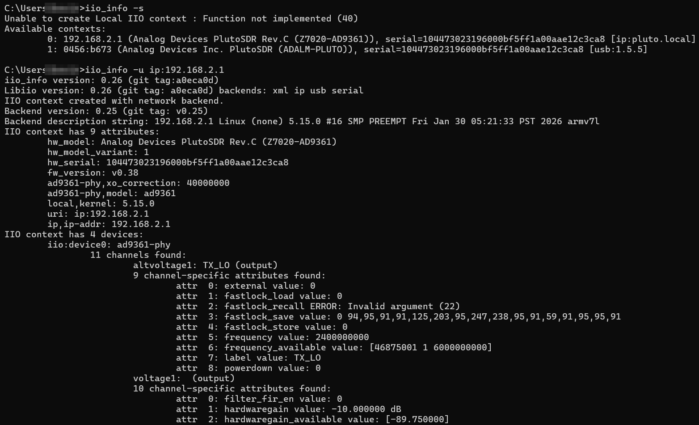

| Scenario | URI setting |
|---|---|
| Single-board loopback | Set `tx_uri` and `rx_uri` to the same PlutoSky R2. |
| Two PCs with one R2 each | Set `tx_uri` to A's local R2 and `rx_uri` to B's local R2. Both PCs may use `ip:192.168.2.1` when their USB networks are independent. |
| Devices on the same LAN | Give each R2 its own address and enter that URI in the flowgraph on the corresponding PC. |

## 2. Software Loopback Simulation

### 2.1 Flowgraph and configuration

Open `05_QPSK_File_Simulation.grc` in GNU Radio Companion (GRC). Check the file settings: the input should point to `sample.mp4` and the output to `received.mp4` in a folder you can write to.

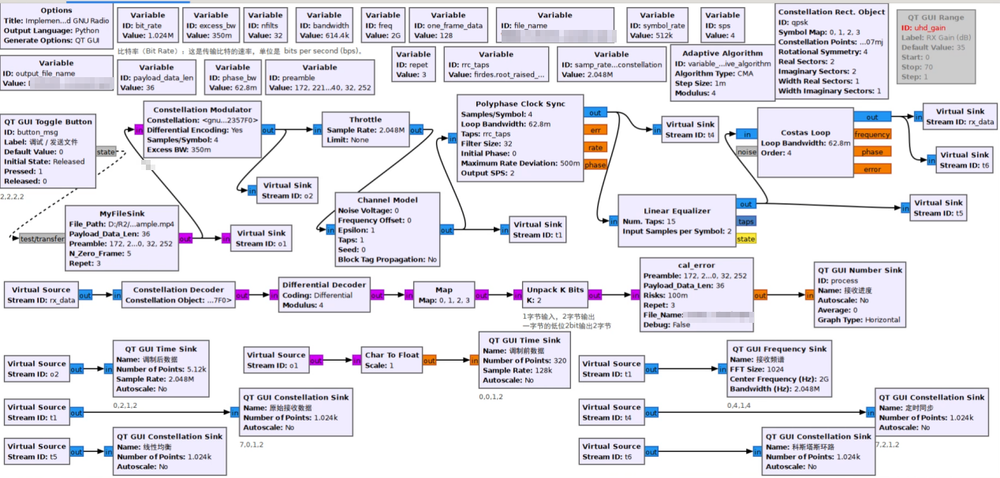

The upper part of the flowgraph generates the QPSK signal and feeds it to the software receiver. The lower part makes the symbol decisions, recovers the bits and receives the file. Virtual Source blocks route data from the main signal path to the time-domain, spectrum and four receiver constellation displays.

### 2.2 Start debug mode and send the video file

Run the flowgraph and watch the time-domain data before and after modulation, the received spectrum, the four receiver constellations and the file reception progress. The program starts by sending debug frames, so a file progress of 0% is normal at this stage.

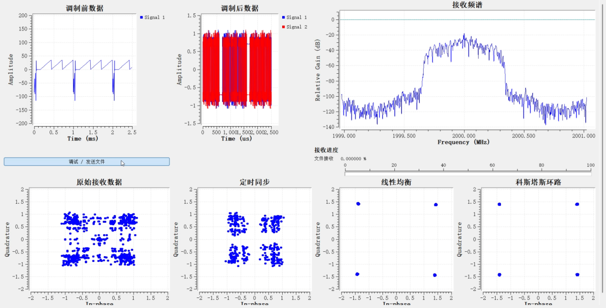

The four constellation displays show the QPSK receiver working through synchronization. The raw received samples include transitions from pulse shaping, plus noise, frequency offset and channel effects. Timing synchronization separates the symbol clusters and the linear equalizer compensates for the channel response. Costas carrier synchronization then gives four clear QPSK clusters. A stable four-cluster pattern at the Costas output means the receiver has locked.

After checking the receiver, click **Debug / Send File** once and keep the flowgraph running. The file frames travel through the same QPSK signal path, and the reception progress increases as the file is recovered.

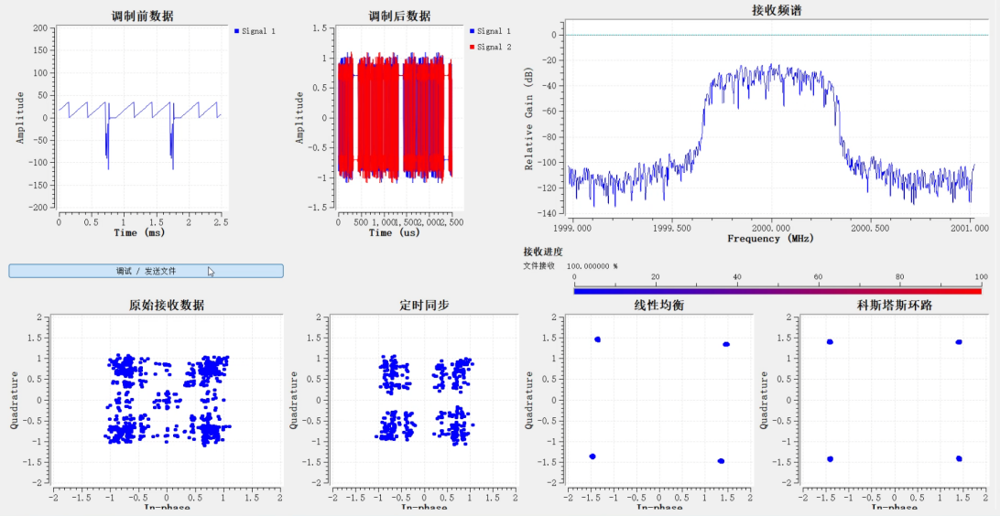

### 2.3 Verify the result

When the progress reaches 100%, go to the folder set by `output_file_name`, open `received.mp4` in a player and check that it plays normally.

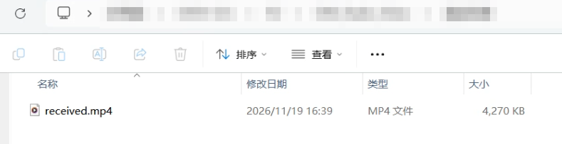

Use PowerShell to check the byte count and the SHA-256 hash of the source and received files:

```powershell
Add-Type -AssemblyName System.Windows.Forms
$videoDialog = New-Object System.Windows.Forms.OpenFileDialog
$videoDialog.Title = 'Select the received video file'
$videoDialog.Filter = 'MP4 video (*.mp4)|*.mp4|All files (*.*)|*.*'

if ($videoDialog.ShowDialog() -eq [System.Windows.Forms.DialogResult]::OK) {
    $videoFile = Get-Item -LiteralPath $videoDialog.FileName
    $videoHash = Get-FileHash -LiteralPath $videoFile.FullName -Algorithm SHA256
    [PSCustomObject]@{
        FilePath = $videoFile.FullName
        Bytes    = $videoFile.Length
        SHA256   = $videoHash.Hash
    } | Format-List
}
```

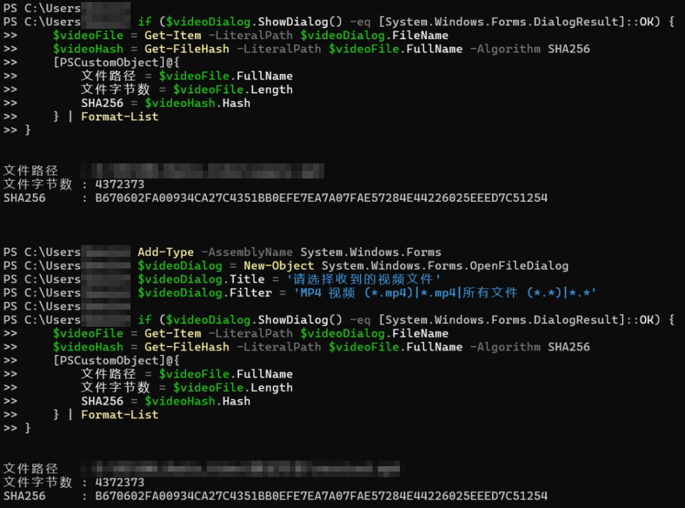

In this example `sample.mp4` and `received.mp4` are both 4,372,373 bytes and have the same SHA-256 hash, so the file recovered by the software loopback is identical to the source.

## 3. Single-Board RF Loopback

### 3.1 Board connection and project setup

In single-board mode one PlutoSky R2 both transmits and receives. Connect PlutoSky R2 to the PC over USB and connect test antennas to TX1 and RX1. The signal returns through the antenna path.

Open `08_QPSK_File_Loopback_R2.grc`.

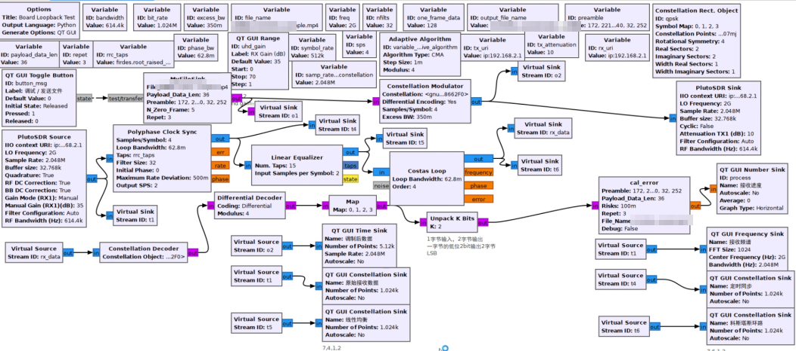

### 3.2 Start the board and send the video

#### Start the flowgraph

Click **Run**. PlutoSky R2 starts transmitting debug frames and receives them through the antennas. Watch the spectrum, the four receiver constellations and the progress indicator. File progress stays at 0% in debug mode.

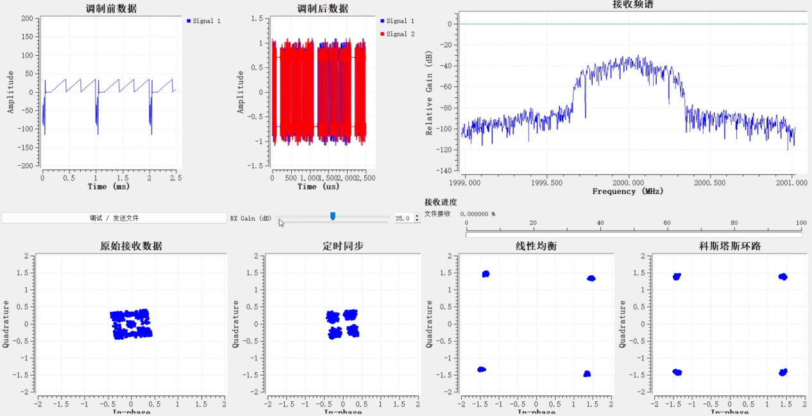

#### Send the file

When the Costas output shows four main phase regions, click **Debug / Send File** once. Keep the USB connection, the antennas and the program running and watch the reception progress increase.

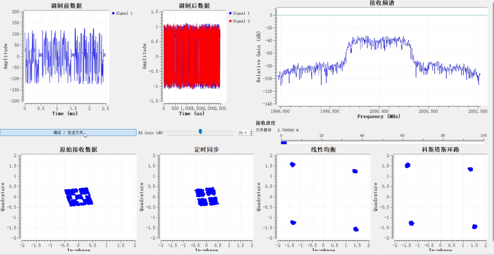

### 3.3 Verify the result

Keep the flowgraph running until the whole file has been received. Find `received.mp4` at the configured output path and check that it plays normally.

On the same PC, select `sample.mp4` and then `received.mp4` with the PowerShell script from section 2.3 and compare the byte counts and SHA-256 hashes.

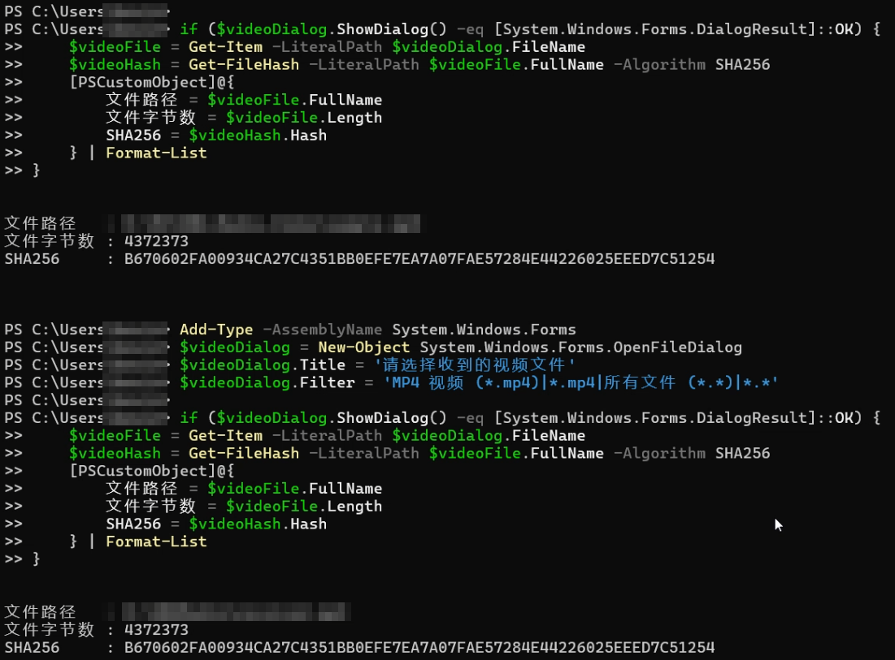

Both files are 4,372,373 bytes with the same SHA-256 hash, so the file was reconstructed correctly.

## 4. File Transfer Between Two PCs

### 4.1 Device connections

PC A is connected to PlutoSky R2-A over USB and acts as the transmitter. PC B is connected to PlutoSky R2-B over USB and acts as the receiver. Connect the transmit antenna to TX1 on R2-A and the receive antenna to RX1 on R2-B.

| PlutoSky R2-A (transmitter) | PlutoSky R2-B (receiver) |
|---|---|
| 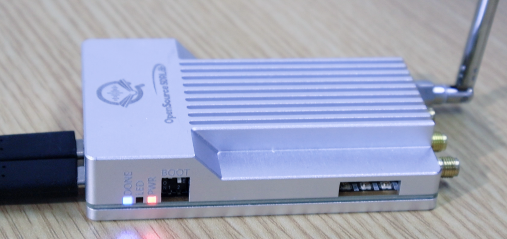 | 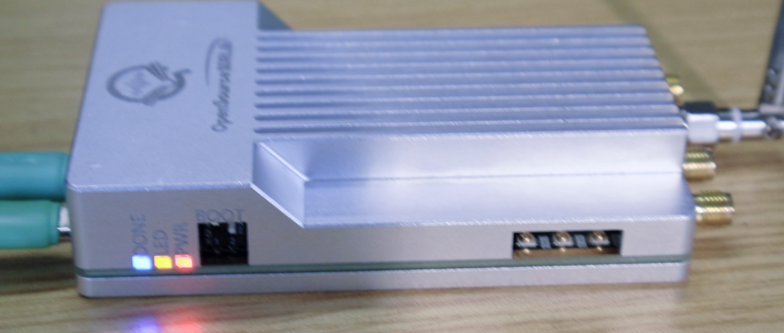 |

Signal path: PC A → PlutoSky R2-A (TX1) → wireless channel → PlutoSky R2-B (RX1) → PC B

Start receiver B first by running `RX_PC_B.grc`, then open `TX_PC_A.grc` on transmitter A.

### 4.2 Start receiver B

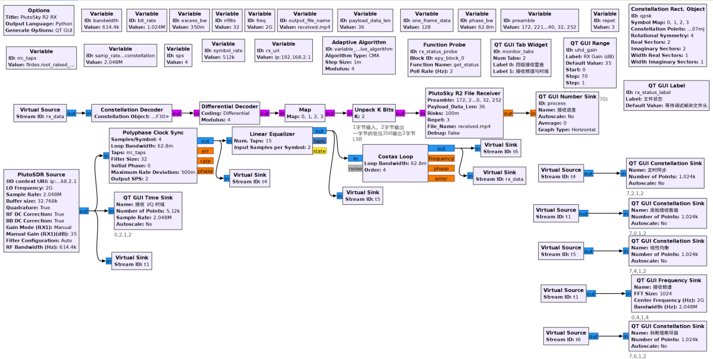

PlutoSDR Source acquires I/Q data from PlutoSky R2-B and passes it through timing synchronization, linear equalization and the Costas loop. After symbol decisions and decoding, the data goes to the PlutoSky R2 File Receiver block, which reports the file status and progress. The four constellation displays and the spectrum display take data from the corresponding processing stages.

On PC B, open the receiver project, check `rx_uri`, the sampling parameters and the output folder, save the project and click **Run**. B now receives continuously.

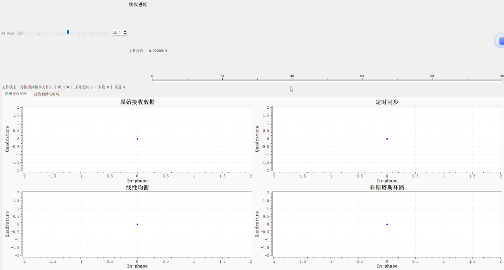

Before A starts transmitting, B may show low-amplitude samples or noise near the centre of the plots, and the file progress stays at 0%. Leave B running and start the transmitter on A.

### 4.3 Start transmitter A

The transmit button sends a control message to MyFileSink that selects debug frames or file frames. Constellation Modulator generates the QPSK I/Q signal. One branch feeds PlutoSDR Sink; the others feed the time-domain, constellation and spectrum displays.

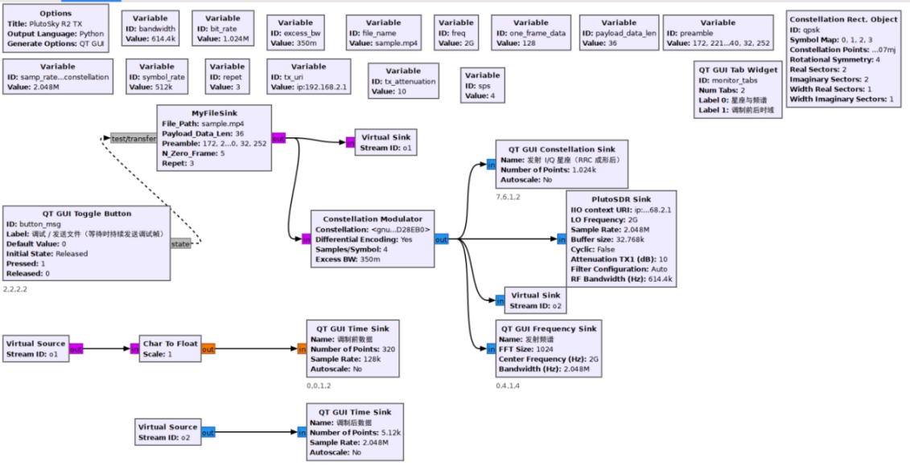

Leave **Debug / Send File** in its default state at first, so that A transmits debug frames continuously.

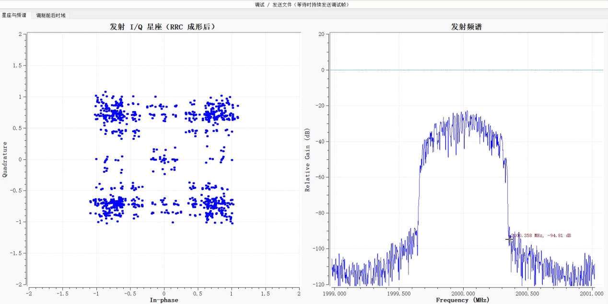

### 4.4 Check the received signal and debug frames

When the signal from A reaches B, the received spectrum shows it at the expected frequency and bandwidth, and the four constellation displays keep updating. Each display shows the samples at a different point of the timing synchronization, linear equalization and carrier synchronization chain.

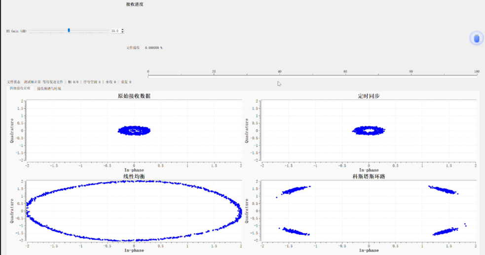

At the current axis ranges, the raw received and timing-synchronized samples sit near the centre of their plots. The linear equalizer output forms a regular ring and the Costas output shows four main phase regions. The equalizer display may stay ring-shaped.

The file status reads "Debug frames OK, waiting for the file": B has recognized the debug frames from A. No file has been sent yet, so progress is 0%. Now start the file transfer on PC A.

### 4.5 Send the file and confirm reception

#### Start the transfer on A

Click **Debug / Send File** once. Transmission starts from the beginning of the file, and B starts counting file frames and updating the progress. Keep both PCs running.

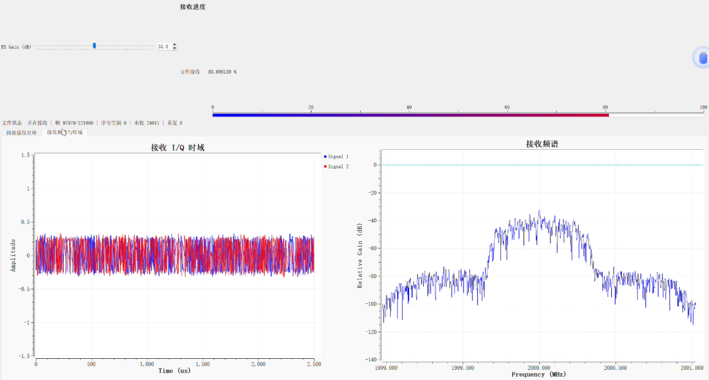

#### Check completion on B

When all data has been received, the CRC check has passed and the file has been saved, the status reads "Reception complete, CRC OK" and progress reaches 100%.

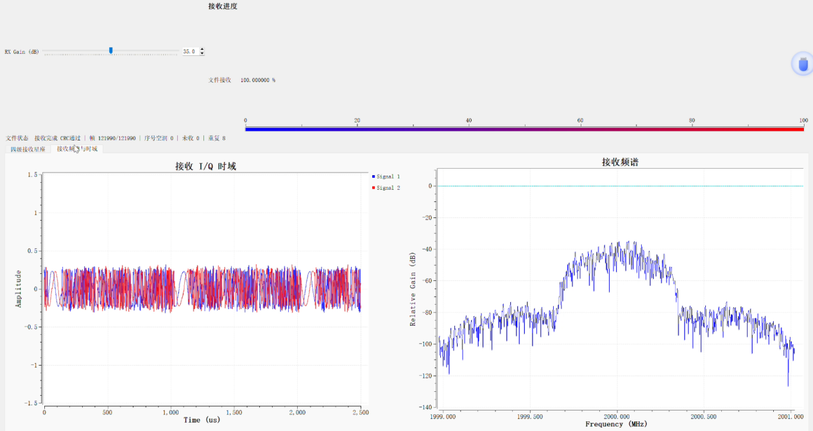

After one complete transfer, A goes back to sending debug frames. The displays on B keep updating and the completed file is kept. On B, open `received.mp4` in a video player and check that it plays normally.

### 4.6 Verify the transfer

#### Source file on A

Run the PowerShell script from section 2.3 and select the `sample.mp4` that A transmitted. Note its byte count and SHA-256 hash.

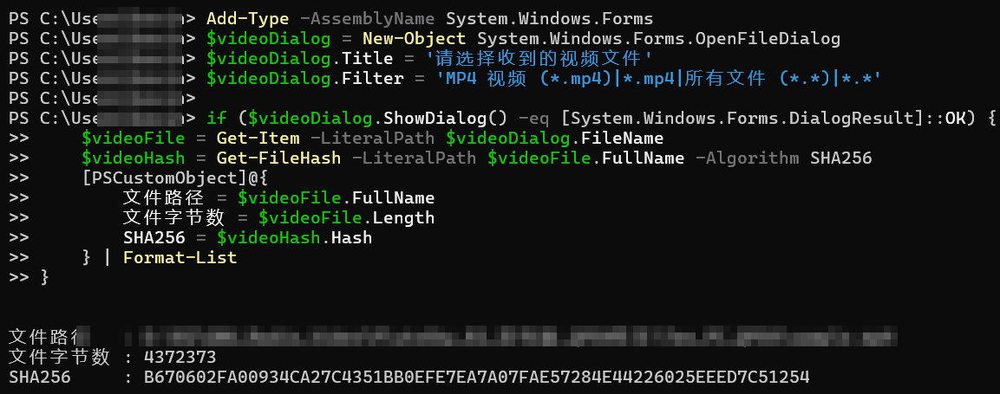

#### Received file on B

Run the same script on B, select the `received.mp4` from this transfer and compare its byte count and SHA-256 hash with the values from A.

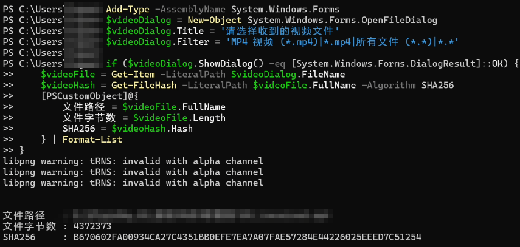

Both files are 4,372,373 bytes with the same SHA-256 hash, so the file received by B is identical to the source.

## 5. Live Camera Video Between Two PCs

This chapter uses two Windows PCs, two PlutoSky R2 boards and a camera on the transmitting PC to capture, transmit, receive and display live colour video. When the camera is pointed at something else, the receiver shows the new picture.

### 5.1 Device connections

On PC A, connect PlutoSky R2-A over USB, connect the camera and attach the transmit antenna to TX1. On PC B, connect PlutoSky R2-B over USB and attach the receive antenna to RX1.

### 5.2 Start receiver B

1. Connect the receiving board and check that it is reachable over IIO. Open `RX_VIDEO_PC_B.grc` and check `freq`, `bit_rate` and the I/Q sample rate. The default `rx_uri` is `ip:192.168.2.1`; set it to the address of the board on PC B.
2. Save the project, click **Generate** on the toolbar and then **Run**.

   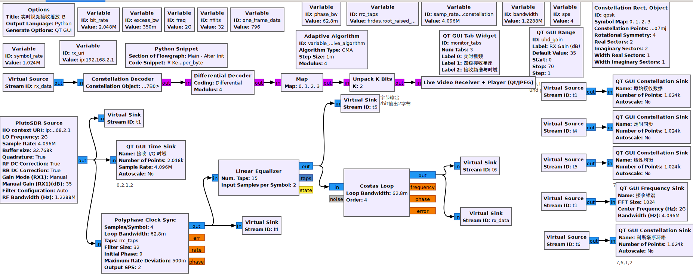

   The receiver flowgraph acquires I/Q samples from PlutoSky R2. The signal passes through polyphase clock synchronization, CMA linear equalization and Costas carrier synchronization, followed by differential QPSK demodulation. The recovered data goes to the video receiver block, which reassembles the JPEG frames for decoding and playback. The constellation, spectrum and time-domain displays show the effect of each stage; the bad-packet and lost-frame counters help judge the link.

3. Open the **Live video** tab. The receiver creates the player and waits for pictures until the transmitter starts.

   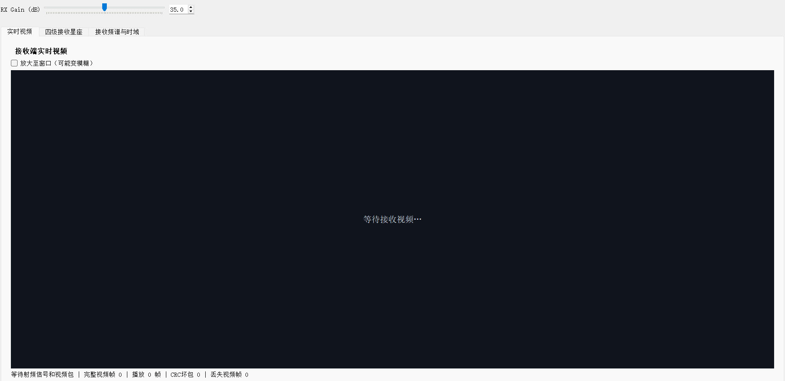

4. Keep the receiver running. The other tabs are **Receiver constellations (4 stages)** and **Received spectrum and time domain**. Below the player, the status line shows complete video frames, displayed frames, packets with failed CRC and lost video frames.

### 5.3 Start the camera transmitter on PC A

1. Connect the transmitting board and the camera. Make sure no other program is using the camera. Open `TX_CAMERA_PC_A.grc` and set `tx_uri` to the address of the board on PC A. Both PCs can keep the default URI when their USB networks are independent.

   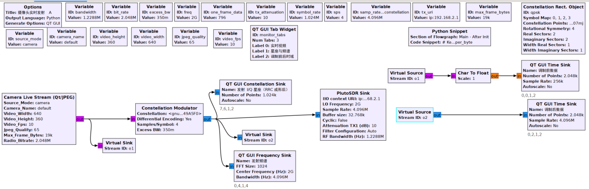

   The transmitter flowgraph captures camera images and compresses them into a JPEG stream. Differential QPSK modulation produces the baseband I/Q signal, which PlutoSky R2 transmits at 2 GHz. The constellation, spectrum and time-domain displays monitor the transmitted signal.

2. Save, generate and run the project. Starting the transmitter opens the camera and captures and transmits images continuously.
3. The transmitter preview is on the **Live video** tab.

Transmitter window:

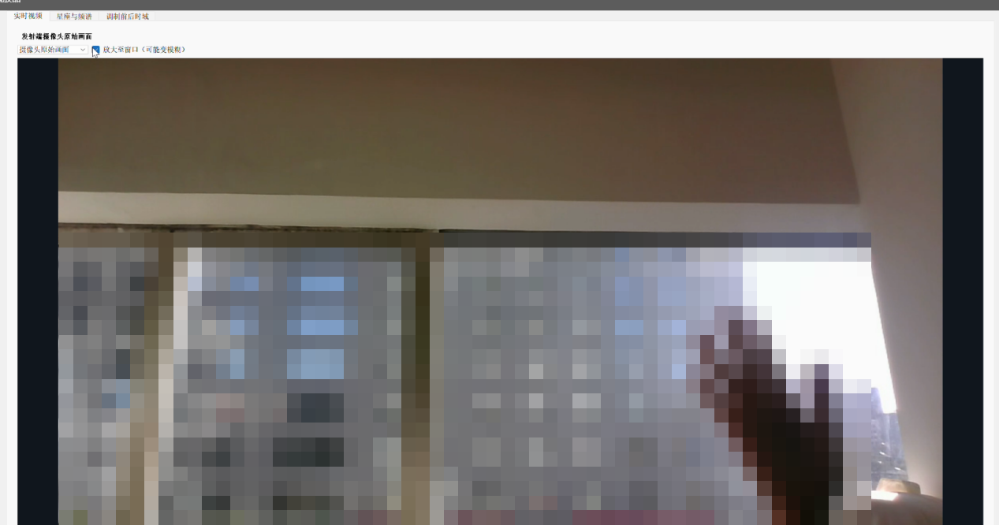

Receiver window:

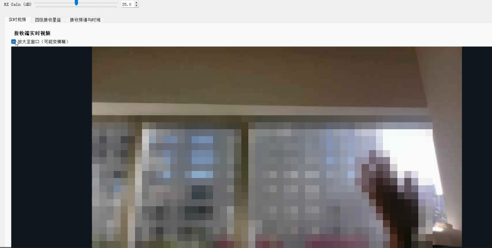

The receiver decodes and displays the live camera pictures and reports bad packets and lost frames. This shows that the QPSK link carries colour video at a low frame rate.
